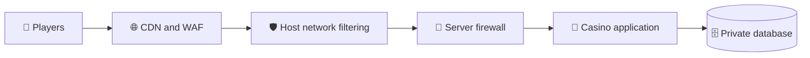

<div align="center">

# 🔐 How to Secure iGaming Dedicated Server: 7 Steps to Follow In 2026
 
### 🎰 Keep your casino or sportsbook online, protected, and trusted by players
 


 
</div>
---
 
🔥 **It is the final minutes of a big football match.** Your sportsbook is at its busiest, bets are landing every second, and then the pages stop loading. Players refresh twice, lose patience, and move to a competitor before you even see the first alert.
 
⚠️ This is not a rare nightmare. For online casinos and betting platforms, attacks tend to arrive at the worst possible moment, because that is exactly when attackers know the damage will be highest.
 
✅ The good news is that most of these incidents are preventable. A well secured **iGaming Dedicated Server** gives you full control over your hardware, your data, and your defenses. In this guide, you will learn **7 practical steps** to lock down your server and protect your platform from DDoS attacks in 2026.
 
> [!TIP]
> **⚡ TL;DR:** Lock admin access ➜ close the firewall and hide the database ➜ encrypt everything ➜ stack your DDoS defenses ➜ patch monthly ➜ back up off the server ➜ monitor 24/7.
 
---
 
## 📖 Table of Contents
 
- [🎯 Why iGaming Platforms Are a Top Target](#-why-igaming-platforms-are-a-top-target)
- [🧭 7 Steps to Secure Your iGaming Dedicated Server](#-7-steps-to-secure-your-igaming-dedicated-server)
  - [🔑 Step 1: Lock Down Admin Access](#-step-1-lock-down-admin-access)
  - [🧱 Step 2: Set Up a Firewall and Keep Your Database Private](#-step-2-set-up-a-firewall-and-keep-your-database-private)
  - [🔒 Step 3: Encrypt Every Connection](#-step-3-encrypt-every-connection)
  - [🌊 Step 4: Build Layered DDoS Protection](#-step-4-build-layered-ddos-protection)
  - [🩹 Step 5: Patch and Harden on a Schedule](#-step-5-patch-and-harden-on-a-schedule)
  - [💾 Step 6: Back Up Off the Server and Test Your Restores](#-step-6-back-up-off-the-server-and-test-your-restores)
  - [📡 Step 7: Monitor Around the Clock and Prepare for Incidents](#-step-7-monitor-around-the-clock-and-prepare-for-incidents)
- [✅ Quick iGaming Server Security Checklist](#-quick-igaming-server-security-checklist)
- [🚫 Common Security Mistakes iGaming Operators Make](#-common-security-mistakes-igaming-operators-make)
- [🚀 QloudHost: Secure iGaming Dedicated Server Hosting in Amsterdam](#-qloudhost-secure-igaming-dedicated-server-hosting-in-amsterdam)
- [❓ FAQs](#-faqs)
- [🏁 Conclusion](#-conclusion)
---
 
## 🎯 Why iGaming Platforms Are a Top Target
 
Online casinos, sportsbooks, and poker rooms sit at a rare crossroads of money, personal data, and real-time traffic. That mix makes them a favorite target for cybercriminals.
 
iGaming sites handle player balances, deposits, withdrawals, identity documents, and payment callbacks around the clock. A single weak point can expose all of it.
 
| 🎭 Threat | 💥 What it does | 🎯 What it hits |
|---|---|---|
| 🌊 DDoS flood | Overloads your server so players cannot connect | The whole platform |
| 🤖 Credential stuffing | Tests stolen passwords on player logins | Player accounts |
| 💉 Injection attacks | Abuses input fields to reach your database | Balances and personal data |
| 🎁 Bonus abuse bots | Farm your promotions at scale | Your marketing budget |
 
Some DDoS criminals even demand payment to stop the attack.
 
Moving to an iGaming Dedicated Server solves part of the problem. The machine is yours alone, so no neighbor can slow you down or share your disks. But the hardware is only the foundation. The security on top of it is your job, and that is exactly what the next 7 steps cover.
 
---
 
## 🧭 7 Steps to Secure Your iGaming Dedicated Server
 
Think of server security as layers, not a single lock. Each step below closes one door, and together they make your platform a much harder target.
 
| # | 🛠️ Step | 🛡️ Protects you from |
|---|---|---|
| 1 | 🔑 Lock down admin access | Stolen logins and brute force |
| 2 | 🧱 Firewall and private database | Direct database attacks |
| 3 | 🔒 Encrypt every connection | Data interception and fake callbacks |
| 4 | 🌊 Layered DDoS protection | Floods, bots, and downtime |
| 5 | 🩹 Patch and harden | Known software flaws |
| 6 | 💾 Off-server backups | Ransomware and data loss |
| 7 | 📡 Monitoring and incident plan | Slow detection and panic |
 
---
 
### 🔑 Step 1: Lock Down Admin Access
 
The easiest way into a server is usually the front door someone forgot to lock. Admin access deserves the strictest rules on your whole system.
 
- ✔ Use **SSH keys** instead of passwords, and disable both password login and direct root login.
- ✔ Allow SSH and admin panels only from **known IP addresses**, or place them behind a VPN.
- ✔ Turn on **two-factor authentication** for your control panel and your casino back office.
- ✔ Give every team member a **separate account** with only the rights they need.
- ✔ Install **Fail2ban** to block repeated failed login attempts automatically.
> [!IMPORTANT]
> Do not overlook the back office. A stolen admin login can approve a fake withdrawal as easily as a hacked server can. Review who has access every month and remove former staff or contractors right away.
 
<details>
<summary>🧪 <b>Example: SSH hardening (click to expand)</b></summary>
```bash
# /etc/ssh/sshd_config
PermitRootLogin no
PasswordAuthentication no
PubkeyAuthentication yes
MaxAuthTries 3
AllowUsers deploy admin
 
# Apply the change (the service is named "ssh" on Debian and Ubuntu)
sudo systemctl reload sshd
 
# Install Fail2ban
sudo apt install fail2ban     # Debian / Ubuntu
sudo dnf install fail2ban     # AlmaLinux / RHEL family
```
 
</details>
---
 
### 🧱 Step 2: Set Up a Firewall and Keep Your Database Private
 
A firewall decides what can reach your server and what gets stopped at the gate. The rule is simple: **block everything by default and open only what your platform truly needs.**
 
| 🔌 Port | 📦 Service | 🚦 Exposure |
|---|---|---|
| 80 and 443 | HTTP and HTTPS | ✅ Public |
| 22 | SSH | 🔒 Trusted IPs only |
| 3306 | MySQL / MariaDB | ❌ Never public |
| 5432 | PostgreSQL | ❌ Never public |
 
Your database holds player balances, bet history, and personal data, so it needs special care. Bind it to localhost or a private network so that only your application can reach it.
 
Two more habits help a lot:
 
- 🧑‍🔧 Create **separate database users** with the minimum permissions each service needs.
- 🕸️ Place a **web application firewall (WAF)** in front of your site to filter SQL injection and cross-site scripting attempts.
On larger platforms, run the database on **its own server** so a breach on the web layer cannot reach it directly.
 
> [!WARNING]
> Allow your own IP for SSH **before** you enable a firewall, and keep a second session open while you test. A wrong rule can lock you out of your own server.
 
<details>
<summary>🧪 <b>Example: firewall and database binding (click to expand)</b></summary>
```bash
# UFW (Debian / Ubuntu)
sudo ufw default deny incoming
sudo ufw default allow outgoing
sudo ufw allow 80/tcp
sudo ufw allow 443/tcp
sudo ufw allow from 203.0.113.10 to any port 22 proto tcp   # replace with your admin IP
sudo ufw enable
 
# firewalld (AlmaLinux / RHEL family)
sudo firewall-cmd --permanent --add-service=http
sudo firewall-cmd --permanent --add-service=https
sudo firewall-cmd --permanent --add-rich-rule='rule family="ipv4" source address="203.0.113.10" port port="22" protocol="tcp" accept'
sudo firewall-cmd --permanent --remove-service=ssh
sudo firewall-cmd --reload
 
# MySQL / MariaDB: only listen locally
# bind-address = 127.0.0.1
 
# PostgreSQL: only listen locally
# listen_addresses = 'localhost'
```
 
</details>
---
 
### 🔒 Step 3: Encrypt Every Connection
 
Casinos and sportsbooks move sensitive data all day long: logins, deposits, withdrawals, and identity documents. Every connection that carries it should be encrypted.
 
- 🔐 Serve every page, API, and payment callback over **HTTPS**, using TLS 1.2 at minimum and TLS 1.3 preferred.
- 📌 Turn on **HSTS** so browsers never fall back to an insecure connection.
- 🔄 Renew certificates **automatically** so an expired certificate never takes your site down.
- ✍️ **Verify the signature** on every payment webhook so fake callbacks cannot trigger credits.
- 🗄️ Encrypt sensitive stored data, such as KYC documents, and hash passwords with a modern algorithm like **bcrypt or Argon2**.
Keep API keys and secrets out of your source code and store them in protected environment files or a secrets manager. If you run a crypto casino, keep only the funds needed for daily payouts in hot wallets and hold the rest in safer storage.
 
<details>
<summary>🧪 <b>Example: Nginx TLS and HSTS (click to expand)</b></summary>
```nginx
ssl_protocols TLSv1.2 TLSv1.3;
add_header Strict-Transport-Security "max-age=31536000; includeSubDomains" always;
```
 
```bash
# Confirm automatic certificate renewal works
sudo certbot renew --dry-run
```
 
</details>
---
 
### 🌊 Step 4: Build Layered DDoS Protection
 
DDoS attacks are among the most common threats to iGaming sites. They flood your platform with fake traffic until real players cannot get through. They come in three main types:
 
| 🌪️ Attack type | ⚙️ How it works | 📝 Example |
|---|---|---|
| 🌊 Volumetric | Fills your network bandwidth with massive traffic | UDP floods |
| 🤝 Protocol | Abuses network handshakes to exhaust server resources | SYN floods |
| 🤖 Application layer | Floods login pages, search, or APIs with requests that look like real visitors | HTTP floods |
 
**No single tool stops all three, so you need layers.** Here is how a protected request travels:
 

 
#### 🧅 The 5 Layers of Defense
 
1. 🛰️ **Network protection from your host.** Choose a provider that filters common network attacks before they reach your server. Port capacity matters too, because a server with a 1 Gbps port fills up faster than one with 10 Gbps.
2. 🌐 **A CDN and reverse proxy.** Placing a CDN with DDoS filtering in front of your site absorbs traffic and hides your real server IP. Make sure your origin IP does not leak through old DNS records, and allow web traffic to your server only from your CDN's published IP ranges.
3. ⚙️ **Server level tuning.** Enable SYN cookies, set connection limits, and use rate limiting in Nginx or Apache to slow down abusive clients.
4. 🤖 **Bot and login protection.** Add CAPTCHA or challenge pages to registration and login, and rate limit these pages to stop bots and credential stuffing.
5. 📞 **A response plan.** Decide in advance who contacts your host, who enables stricter protection, and how you inform players.
> [!CAUTION]
> If an attacker demands payment to stop a DDoS attack, **do not pay**. Paying rarely ends the attacks and often invites more.
 
<details>
<summary>🧪 <b>Example: kernel tuning and Nginx rate limiting (click to expand)</b></summary>
```bash
# /etc/sysctl.d/99-ddos.conf
net.ipv4.tcp_syncookies = 1
net.ipv4.conf.all.rp_filter = 1
net.ipv4.tcp_max_syn_backlog = 4096
 
# Apply the settings
sudo sysctl --system
```
 
```nginx
# In the http block
limit_req_zone  $binary_remote_addr zone=login:10m rate=5r/m;
limit_conn_zone $binary_remote_addr zone=perip:10m;
limit_req_status 429;
 
# In your server block
location /login {
    limit_req  zone=login burst=5 nodelay;
    limit_conn perip 20;
}
```
 
</details>
---
 
### 🩹 Step 5: Patch and Harden on a Schedule
 
Attackers love old software because known flaws are easy to exploit. Regular patching is one of the cheapest and most effective defenses you have.
 
Apply operating system and software security updates **every month, at your lowest traffic hour**, so you never patch in the middle of a big match. Critical security fixes should go in sooner, ideally after a quick test on a staging server. Do not forget the pieces on top of the OS, like your control panel, web server, PHP or Node runtime, and game platform plugins.
 
**Hardening matters just as much as patching:**
 
- 🧹 Remove services and packages you do not use.
- 🦠 Run a malware scanner on a schedule, using tools like ClamAV or Imunify.
- 🧱 Use SELinux or AppArmor to limit what a compromised service can touch.
- 🔍 Use file integrity monitoring to spot unexpected changes to core files.
> [!NOTE]
> A smaller server footprint simply gives attackers fewer places to look.
 
<details>
<summary>🧪 <b>Example: monthly patch window (click to expand)</b></summary>
```bash
# Debian / Ubuntu
sudo apt update && sudo apt upgrade -y
 
# AlmaLinux / RHEL family
sudo dnf upgrade -y
 
# Reboot only if a kernel or core library was updated
```
 
</details>
---
 
### 💾 Step 6: Back Up Off the Server and Test Your Restores
 
Even the best defenses can fail, and when that day comes, a good backup decides whether you lose an hour or your whole business.
 
> [!WARNING]
> A backup stored on the same disk as your database is **not** a real backup.
 
Take database backups **several times a day** and copy them to a second location away from the server. Follow the **3-2-1 rule**:
 
| 🔢 Rule | 📦 Meaning |
|---|---|
| **3** | Three copies of your data |
| **2** | On two different types of storage |
| **1** | With one copy offsite |
 
Keep at least one copy **offline or immutable**, so ransomware cannot encrypt it too.
 
Just as important, **test your restores**. Many operators discover a broken backup only when they need it. Once a quarter, restore a backup on a test server and measure how long it takes. That number tells you how much downtime and data loss you could face in a real emergency.
 
<details>
<summary>🧪 <b>Example: a simple backup routine (click to expand)</b></summary>
```bash
#!/bin/bash
# /usr/local/bin/db-backup.sh
mysqldump --single-transaction --routines --events --all-databases | gzip > /backups/db-$(date +%F-%H%M).sql.gz
 
# Encrypt the file (gpg, age, or restic) before it leaves the server, then copy it off-server
rsync -az /backups/ backup@offsite.example.com:/srv/casino-backups/
```
 
```bash
# crontab: run every 6 hours (4 backups a day)
0 */6 * * * /usr/local/bin/db-backup.sh
```
 
</details>
---
 
### 📡 Step 7: Monitor Around the Clock and Prepare for Incidents
 
You cannot defend what you cannot see. Continuous monitoring lets you spot trouble early, often before players notice anything.
 
| 👀 Watch this | 🔔 Alert when |
|---|---|
| 🖥️ CPU and memory | Usage stays high for several minutes |
| 💽 Disk space | Free space drops below a safe level |
| 🌐 Network traffic | A sudden, unusual spike appears |
| ⏱️ Response times | Pages or APIs slow down |
| 🔑 Failed logins | Many attempts arrive in a short time |
| 💸 Withdrawals and wallet changes | Requests look unusual |
 
Collect logs in one place and keep records of admin actions, logins, and wallet changes, because they are priceless during an investigation or a regulator audit. Tools like Prometheus with Grafana, Netdata, Zabbix, or Uptime Kuma can handle the alerts.
 
Watch for suspicious patterns too, such as many accounts created from one IP range. These are often the first signs of bots or fraud.
 
**📝 Finally, write a simple incident response plan:**
 
1. 👤 List who does what.
2. 🚧 Decide how to isolate a compromised server.
3. ♻️ Document how to restore from backup.
4. 📣 Prepare how you will communicate with players and your licensing authority.
> [!NOTE]
> A plan on paper turns panic into procedure.
 
---
 
## ✅ Quick iGaming Server Security Checklist
 
Use this checklist as a monthly review. If every item is ticked, your server is in far better shape than most.
 
- [ ] SSH keys, two-factor login, and IP restrictions are active
- [ ] The firewall blocks everything by default and the database is private
- [ ] HTTPS is enforced and certificates renew automatically
- [ ] CDN, rate limits, and bot protection are in place
- [ ] Updates are applied and unused services are removed
- [ ] Off-server backups run daily and restores are tested
- [ ] Alerts and an incident response plan are ready
---
 
## 🚫 Common Security Mistakes iGaming Operators Make
 
Even experienced teams slip up. These are the mistakes that cause the most trouble on gambling and betting platforms.
 
| ❌ Mistake | ✅ Better approach |
|---|---|
| Exposing the database or admin panel to the whole internet | Keep them private or limited to trusted IPs |
| Leaving the real server IP visible behind a CDN | Hide the origin and allow only CDN traffic |
| Relying on DDoS protection alone | Add patching, backups, and monitoring |
| Keeping backups on the same server as the data | Store copies off-server |
| Sharing one admin login across the whole team | Use separate accounts with limited rights |
| Assuming the host handles licensing and compliance | Handle licensing, KYC, and certification yourself |
 
---
 
## 🚀 QloudHost: Secure iGaming Dedicated Server Hosting in Amsterdam
 
Good security starts with the right foundation. The server you choose decides how much protection you get from day one and how much you must build on your own.
 
**QloudHost** offers iGaming dedicated servers built for casinos, sportsbooks, and poker rooms. Every server is **single tenant**, so the whole machine is yours.
 
| ⚡ Feature | 📋 Details |
|---|---|
| 🛡️ Basic DDoS protection | Hardware level filtering of common network attacks, included on every plan at no extra cost |
| 🔌 Network ports | 1 Gbps to 10 Gbps. The AMD EPYC 9355P, Intel Xeon 6741P, and AMD EPYC 9655P plans include 10 Gbps and 100 TB of monthly transfer |
| 💽 Storage and memory | NVMe storage and ECC memory on most plans |
| 🔑 Access | Dedicated IPv4, full root access, KVM console, IPMI on request |
| 📍 Location | Amsterdam, Netherlands, with low latency across Europe |
| 🕒 Support | 24/7 engineers on chat and ticket, with a 99.95% uptime target |
| 💸 Billing | Zero setup fees, free migration, and payments in USDT, crypto, cards, PayPal, or bank transfer |
| 🖥️ OS and panels | AlmaLinux, CentOS, Debian, Ubuntu, or Windows Server, with control panels such as DirectAdmin and cPanel |
 
### 💰 A Few Popular Configurations
 
| 🖥️ Server | 🧠 Cores | 💾 RAM | 🔌 Port | 💵 Price |
|---|---|---|---|---|
| Intel Xeon E3-1230v6 | 4 | 32 GB DDR4 ECC | 1 Gbps | $105.99/mo |
| AMD Ryzen 9 9900X | 12 | 64 GB DDR5 | 1 Gbps | $266.99/mo |
| AMD EPYC 4565P | 16 | 64 GB DDR5 ECC | 1 Gbps | $479.99/mo |
| AMD EPYC 7402P ⭐ Most Popular | 24 | 128 GB DDR4 ECC | 1 Gbps | $624.99/mo |
| AMD EPYC 9355P | 32 | 128 GB DDR5 ECC | 10 Gbps | $799.99/mo |
| Intel Xeon 6741P | 48 | 128 GB DDR5 ECC | 10 Gbps | $909.99/mo |
| AMD EPYC 9655P | 96 | 256 GB DDR5 ECC | 10 Gbps | $1664.99/mo |
 
> [!NOTE]
> **One honest note:** the included DDoS protection is basic and designed for common network attacks. For larger or application layer attacks, pair it with the CDN and WAF layers from Step 4. Also remember that a host cannot give you a gaming license. Licensing, KYC, and game certification stay your responsibility as the operator, while QloudHost provides the secure infrastructure underneath.
 
<div align="center">
### 🎯 Ready to build on a strong foundation?
 
[](https://qloudhost.com/igaming-dedicated-servers)
 
</div>
---
 
## ❓ FAQs
 
Here are quick answers to the questions operators ask most often when securing a gaming server.
 
<details>
<summary><b>🔐 Is an iGaming dedicated server more secure than a VPS?</b></summary>
In most cases, yes. A dedicated server gives you isolated hardware with no neighbors, so no other customer can affect your performance or share your disks. Security still depends on how well you configure it.
 
</details>
<details>
<summary><b>🌊 Can a dedicated server stop DDoS attacks completely?</b></summary>
No single server can. Hardware level protection filters common network attacks, but a full defense also needs a CDN, a WAF, rate limiting, and a response plan.
 
</details>
<details>
<summary><b>🔌 Which ports should stay open on a casino server?</b></summary>
Usually only ports 80 and 443 for public traffic, plus SSH restricted to trusted IP addresses. Keep database ports closed to the internet.
 
</details>
<details>
<summary><b>🩹 How often should I update my iGaming server?</b></summary>
Apply regular updates once a month, at your lowest traffic hour. Critical security patches should go in sooner, after a quick test on a staging server.
 
</details>
<details>
<summary><b>💾 How often should I back up my casino database?</b></summary>
Several times a day, with copies stored away from the server. Test a restore every quarter to confirm your backups actually work.
 
</details>
<details>
<summary><b>📜 Do I need a gambling license to use a dedicated server?</b></summary>
Your hosting provider cannot issue a license. You must hold a valid license for every market you accept players from, and you also handle KYC, AML checks, and game certification.
 
</details>
---
 
## 🏁 Conclusion
 
Securing an iGaming Dedicated Server is not about one big fix. It is about a handful of smart habits: locked down admin access, a tight firewall, encrypted connections, layered DDoS protection, regular patching, tested backups, and constant monitoring.
 
Online gaming runs on trust. Players hand over money and personal details because they believe the platform is safe and always available. Every step in this guide protects that trust, along with your revenue and your reputation.
 
Start with the basics today, review your checklist every month, and build your defenses layer by layer. And if you need a strong foundation to build on, choose a provider that offers dedicated hardware, DDoS protection, and 24/7 support.
 
> [!IMPORTANT]
> **🎯 Bottom line:** A secure platform is built in layers. Lock the doors, hide the database, encrypt the traffic, stack your DDoS defenses, patch on schedule, back up off-server, and watch everything. Then launch on secure, high performance infrastructure in Amsterdam with [QloudHost iGaming Dedicated Servers](https://qloudhost.com/igaming-dedicated-servers).
 
<div align="center">

### ⭐ Found this guide useful? Star the repo and share it with a fellow operator!
 
[](https://qloudhost.com/igaming-dedicated-servers)
 
`#iGamingDedicatedServer` `#CasinoHosting` `#SportsbookSecurity` `#DDoSProtection` `#ServerSecurity` `#Amsterdam`
 
</div>
 
Claude finished the response
